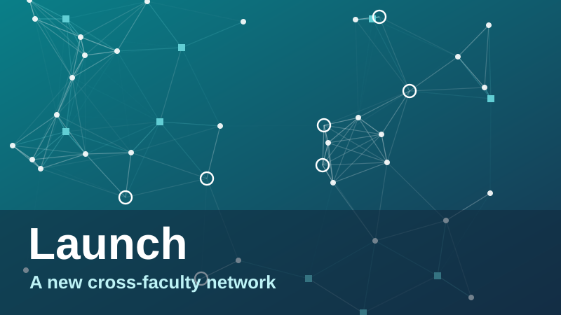
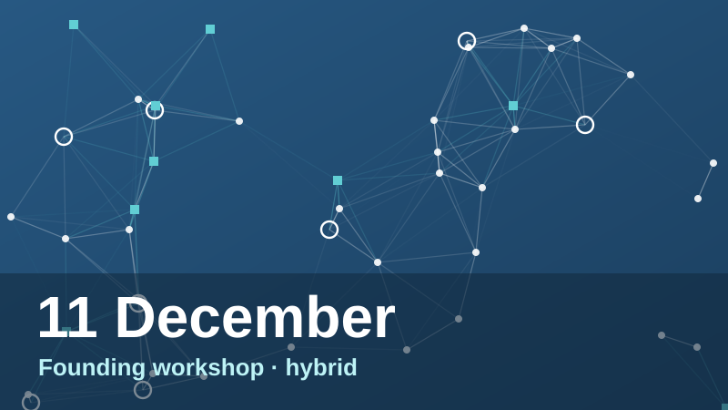

```{=html}
<section class="home-hero" aria-labelledby="hero-title">
  <canvas id="hero-canvas" aria-hidden="true"></canvas>
  <div class="inner">
    <p class="eyebrow">University of Pannonia · Network of Research Excellence</p>
    <h1 id="hero-title">Human- and Society-Centered AI Research Network</h1>
    <p class="tagline">Understanding and designing human–AI–social systems that work for people.</p>
    <div class="actions">
      <a class="btn-pe-light" href="/research/index.html">Explore the research</a>
      <a class="btn-pe btn-ghost" href="/people.html">Meet the people</a>
    </div>
  </div>
  <svg class="wave" viewBox="0 0 1440 90" preserveAspectRatio="none" aria-hidden="true">
    <path d="M0 40 C 240 90, 480 0, 720 38 S 1200 80, 1440 30 L1440 90 L0 90 Z" fill-opacity=".35"/>
    <path d="M0 62 C 260 30, 520 96, 780 60 S 1220 30, 1440 58 L1440 90 L0 90 Z"/>
  </svg>
</section>
```



```{=html}
<section class="home-section" aria-labelledby="q-title">
  <div class="question-grid">
    <div>
      <h2 class="pe-title" id="q-title">The shared question</h2>
      <p class="big-question">AI is changing how people think, learn, decide and work together. When does it leave people more capable on their own – and when does the gain stay tied to the system?</p>
      <p class="section-intro">Our unit of analysis is the <strong>human–AI–social system</strong>: AI outputs redistribute attention, knowledge, responsibility, roles and risks, not only individual decisions. Across all studies we therefore keep three outcomes apart:</p>
      <ul class="outcome-trio">
        <li><strong>Supported performance</strong>what people achieve together with AI</li>
        <li><strong>Durable competence</strong>what remains later, without AI</li>
        <li><strong>Independent initiative</strong>what people start and judge on their own</li>
      </ul>
      <p><a class="btn-pe" href="/approach.html">Our approach</a></p>
    </div>
    <div>
      <ol class="levels-stack" aria-label="Four connected levels of analysis">
        <li><strong>Individual</strong><span>thinking, learning, competence, identity, creativity</span></li>
        <li><strong>Relationships and groups</strong><span>trust, psychological safety, collaboration, human–AI teamwork</span></li>
        <li><strong>Organizations and institutions</strong><span>knowledge sharing, learning, roles, accountability</span></li>
        <li><strong>Society and policy</strong><span>distribution of benefits and burdens, participation, access</span></li>
      </ol>
    </div>
  </div>
</section>
<section class="home-section wash" aria-labelledby="lines-title">
  <div class="inner">
    <h2 class="pe-title" id="lines-title">Nine research lines</h2>
    <p class="section-intro">Psychologists, social scientists, economists, engineers, computer scientists and educators work on connected problems – from the operator on the shop floor to the classroom, the university and the region.</p>
```



```{=html}
  </div>
</section>
<section class="home-section" aria-labelledby="news-title">
  <h2 class="pe-title" id="news-title">News and events</h2>
  <div class="news-grid">
    <a class="news-card" href="/news/posts/2026-11-22-network-launch.html">
      <div class="nc-img"></div>
      <div class="nc-body"><div class="nc-date">22 November 2026</div><div class="nc-title">The University of Pannonia launches the Human- and Society-Centered AI Research Network</div><div class="nc-cat">Network</div></div>
    </a>
    <a class="news-card" href="/news/posts/2026-11-22-founding-workshop.html">
      <div class="nc-img"></div>
      <div class="nc-body"><div class="nc-date">22 November 2026</div><div class="nc-title">Founding workshop on 11 December</div><div class="nc-cat">Events</div></div>
    </a>
    <div class="event-box">
      <span class="ev-kicker">Next event</span>
      <span class="ev-date">11 Dec</span>
      <span class="ev-title">Founding workshop</span>
      <span class="ev-meta">Friday, 13:00–14:30 CET · Nagytanácsterem, University of Pannonia, Veszprém · hybrid</span>
      <a href="/events.html">All events →</a>
    </div>
  </div>
</section>
<script src="/assets/js/hero.js" defer></script>
```
